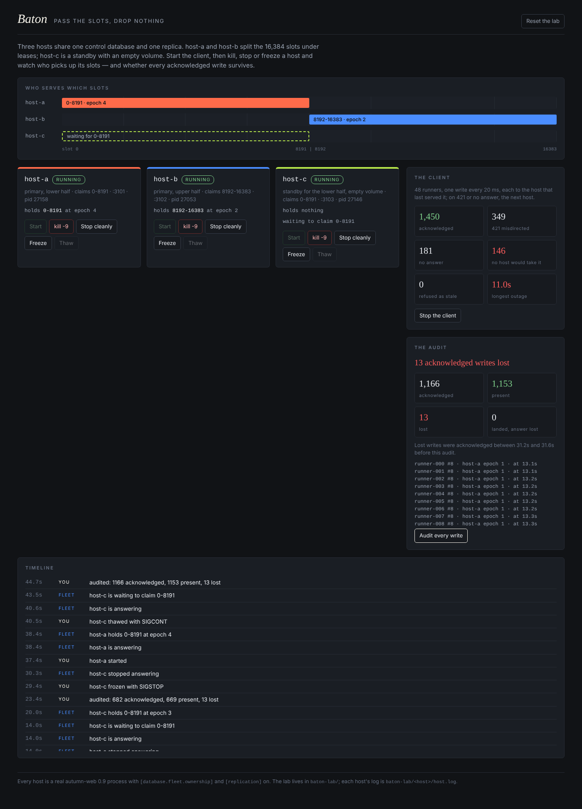

# Baton

A failover lab for autumn-web 0.9's SQLite database fleet in slot mode, with
slot ownership (leases and epoch fencing) and replication. See `PITCH.md`
for what it shows and `docs/FINDINGS.md` for what it found.



## Run it

```sh
cargo run            # the console on http://localhost:3000
```

The console makes `./baton-lab/`, writes each host's `autumn.toml` from
`crates/baton-app/host.toml`, and starts host-a (`:3101`, slots 0–8191) and
host-b (`:3102`, slots 8192–16383) as child processes. host-c (`:3103`) is a
standby for 0–8191 with an empty volume; start it when you have killed
host-a. Ctrl-C stops every host. A console that crashed leaves pid files;
the next one kills those hosts on boot.

```
baton-lab/
  shared/control.db     the ownership table, shared by every host
  shared/replica/       the replication destination, shared
  host-a/volume/        host-a's fleet root (its slot files)
  host-a/host.log       its log
  …
```

In the console:

| Button | What it does |
|---|---|
| Start the client | 48 runners, one write every 20 ms each, to the host that last served the runner; on 421 or no answer, the next host. |
| kill -9 | SIGKILL. Nothing more ships to the replica. |
| Stop cleanly | SIGTERM. |
| Freeze / Thaw | SIGSTOP / SIGCONT: a zombie that still believes it owns its range. |
| Audit every write | Read every runner back from whichever host serves it, and check every acknowledged write is there. |
| Reset the lab | Stop everything, delete `baton-lab/`, start the primaries. |

## Layout

- `crates/relay` — pure: slot ranges, the lab's hosts, the client's ledger
  (epoch watermarks) and the audit. Property-tested; the ledger has a Verus
  model.
- `crates/baton-app` — `baton-app host` (the fleet, `POST /api/write`,
  `GET /api/read`) and `baton-app` (the console: supervisor, poller,
  workload, audit, page).
- `crates/baton-app/tests/failover.rs` — the lab's claims against three real
  host processes: split, kill -9 takeover within the RPO, fail-back restores,
  thawed zombie refused.
- `tools/drill.py` — the console drill over HTTP, stdlib only.
- `verus/src/ledger.rs` — the watermark is monotone and bounds every counted
  acknowledgement; the audit partitions what was acknowledged.

## Verify

```sh
./verify.sh            # fmt, clippy, tests, console + drill, routes audit, Verus
./verify.sh --quick    # without the console and the drill
```

`verify.sh` on the Mac is the authoritative gate; Verus has not been run in
the cloud build (see `docs/SPEC.md` section 5).
